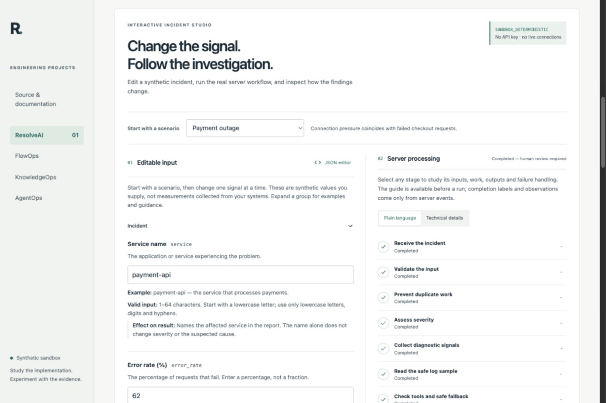

<p align="center"></p>

# ResolveAI

Evidence-first incident investigation: collect scoped diagnostics, investigate an alert, and produce a report whose conclusions link back to evidence. Human operators retain control of decisions and remediation.

**Source release 0.3.7.** The default studio is a deterministic, synthetic demonstration. It runs server-side code without a model key, production database or external action. The optional private runtime has authenticated users, durable PostgreSQL jobs and restricted PostgreSQL/Redis diagnostics. These runtimes are deliberately separate.

## Run the studio

Install Docker Engine with Compose v2:

```sh
git clone https://github.com/prasanthp01/resolveai.git
cd resolveai
docker compose -f deploy/compose.sandbox.yaml up --build -d --wait
```

Open **http://127.0.0.1:8132/projects/resolveai/app/studio**. Choose a preset, change its metrics, run the investigation and inspect its measured stages and evidence-cited result. Try a provider failure or insufficient-evidence scenario. Export a result or compare successive runs. The architecture tab explains the components and version history.



The container binds to loopback, runs as a non-root user and has a read-only filesystem. Stop with `docker compose -f deploy/compose.sandbox.yaml stop`. Sandbox runs expire and are lost on restart; this profile stores no private data. It supports one API process. See [self-hosting](docs/v4/SELF_HOST.md) for configuration and HTTPS deployment.

For local source development, install Python 3.12, uv and Node.js 22:

```sh
uv sync --frozen
npm --prefix web ci --ignore-scripts
PUBLIC_ORIGIN=http://127.0.0.1:5179 uv run uvicorn app.sandbox.main:app --host 127.0.0.1 --port 8131 --workers 1
# In another terminal:
npm --prefix web run dev
```

Open `http://127.0.0.1:5179/projects/resolveai/app/studio`.

## Private investigation runtime

The private runtime includes scoped and revocable credentials, signed webhooks, CSRF-protected owner sessions, transactional job acceptance, deduplication, leases, fencing, bounded retries, audit events and encrypted connector credentials. Diagnostic roles and Redis ACLs restrict what it can read. It does not run arbitrary SQL, shell commands or automatic remediation.

Follow [deployment](docs/DEPLOYMENT.md), [connector permissions](docs/CONNECTORS.md) and [operations](docs/OPERATIONS.md). Use HTTPS, generated secrets, restricted networking and tested backups before accepting private data. An optional OpenAI-compatible adapter exists; live-provider quality, spend and cross-project live inference have not been validated. The default public studio never enables it.

## Verify

Tests require disposable PostgreSQL and Redis services. Run from a fresh checkout and confirm ports 55433–55435 are free:

```sh
uv sync --frozen
uv run python scripts/test_config.py
docker compose --env-file .env -f deploy/compose.test.yaml up -d --wait
uv run alembic upgrade head
uv run pytest -q
uv run ruff check app tests scripts alembic
uv run mypy app
npm --prefix web ci --ignore-scripts
npm --prefix web run build
uv run python scripts/architecture.py --check
uv run python scripts/scan_source.py
```

Never point tests or recovery drills at a live database. Architecture snapshots are immutable; runtime changes require a new snapshot and regenerated documentation.

## Documentation

- [Architecture](docs/ARCHITECTURE.md), [learning map](docs/LEARNING_MAP.md), [data model](docs/DATA_MODEL.md)
- [API and examples](docs/API.md), [simulation guide](docs/SIMULATION_GUIDE.md)
- [Threat model](docs/THREAT_MODEL.md), [security policy](SECURITY.md)
- [Release readiness and tested limits](docs/RELEASE_READINESS.md)
- [Contributing](CONTRIBUTING.md), [third-party notices](THIRD_PARTY_NOTICES.md)

The [public portfolio demo](https://portfolio.gappazappa.in/projects/resolveai) is a separately deployed integration; its version can differ from this source release. No commercial-scale reliability, independent penetration test or production-remediation capability is claimed. Synthetic model costs are not invoices. Licensed under Apache-2.0.
