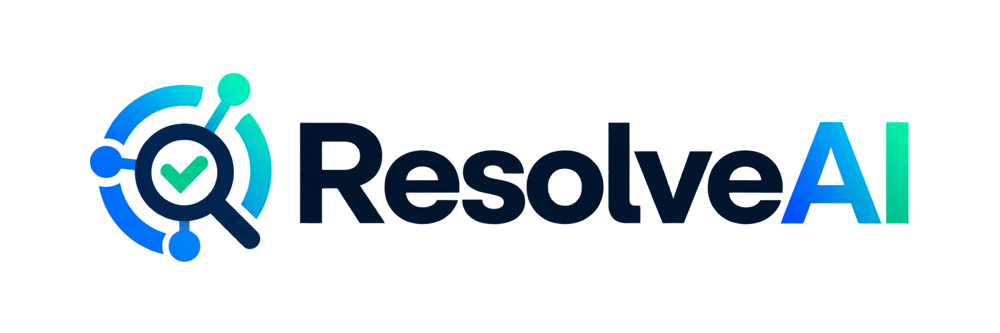
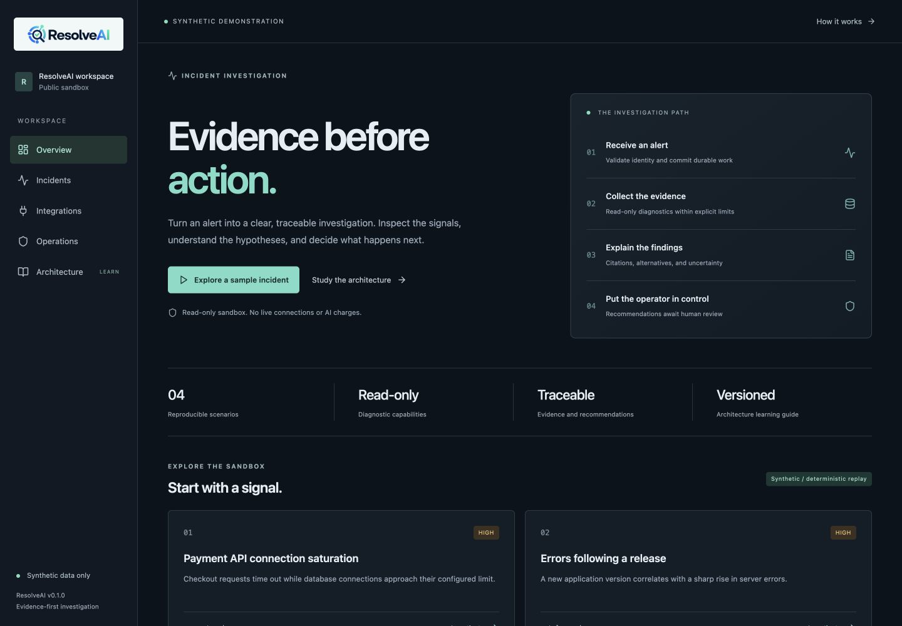

<p align="center"></p>

# Evidence-first incident investigation

ResolveAI accepts scoped alerts, gathers restricted diagnostic evidence, and produces traceable reports for human review. It is a single-tenant self-hosted public beta. The public demo uses synthetic data and deterministic analysis; it performs no production remediation or paid inference.

[Open the synthetic demo](https://portfolio.gappazappa.in) · [Study the architecture](https://portfolio.gappazappa.in/architecture)

Explore four scenarios: PostgreSQL connection pressure, a release regression, Redis pressure, and upstream rate limiting. The `/architecture` page explains the actual high- and low-level design with diagrams, code references, walkthroughs, and retained versions.



See [release evidence](docs/RELEASE_EVIDENCE.md) for the verified deployment status and [release gates](docs/RELEASE_GATES.md) for limits. An implementation, a successful test, and an owner acceptance decision are separate facts.

## Run the synthetic demo locally

Prerequisites: Python 3.12+, uv, Node.js 22+, and npm. Docker is only required for private database workflows and integration tests.

```sh
uv sync --frozen
npm --prefix web ci --ignore-scripts
npm --prefix web run build
DEMO_MODE=true uv run uvicorn app.main:app --host 127.0.0.1 --port 8130
```

Open `http://localhost:8130` and `http://localhost:8130/architecture`. No administrator or model credential is needed. Avoid copying private `.env` files into a public demo instance.

## Run the private test environment

Use a fresh checkout: the configuration script preserves any existing `.env`.

```sh
uv run python scripts/test_config.py
docker compose --env-file .env -f deploy/compose.test.yaml up -d --wait
uv run alembic upgrade head
uv run python -m app.cli bootstrap --username owner
uv run uvicorn app.main:app --host 127.0.0.1 --port 8130
# In another terminal:
uv run python -m app.jobs.worker
```

Sign in at `/login`, register an application and environment, then create a scoped credential. Send the sample event in [API.md](docs/API.md). The test configuration uses disposable local ports 55433–55435; verify they are free first. It disables secure cookies only for loopback HTTP testing. Production must use HTTPS and secure cookies.

## What is implemented

- Owner sessions, CSRF/origin protection, expiring/revocable source credentials, and signed webhooks.
- Transactional incident/job acceptance, source-scoped deduplication, leases, heartbeats, fencing, and bounded retries.
- Restricted PostgreSQL/Redis diagnostics, tested against isolated services and restricted roles/ACLs.
- Evidence-cited reports, visible uncertainty, audit entries, operator notes, report JSON export, and safe retry.
- Four synthetic scenarios, responsive UI, and versioned architecture learning views.
- An optional configured model adapter; live-provider evaluation is explicitly recorded as NOT RUN in this synthetic-only delivery.

There is no public signup, multi-tenant SaaS, arbitrary SQL/shell/HTTP tool, customer-side collector, autonomous repair, or claim of commercial-scale reliability.

## Verify

```sh
uv run ruff check app tests scripts alembic
uv run ruff format --check app tests scripts alembic
uv run mypy app
uv run pytest -q
uv run alembic check
npm --prefix web run build
uv run python scripts/architecture.py --check
uv run python scripts/scan_source.py
```

Run tests only against the dedicated test Compose project. [TEST_REPORT.md](docs/TEST_REPORT.md) records actual results; fixture success is not a live-model benchmark.

## Learn, deploy, contribute

- [Architecture](docs/ARCHITECTURE.md) and [versioning](docs/ARCHITECTURE_VERSIONING.md)
- [Learning map](docs/LEARNING_MAP.md), [agent design](docs/AGENT_DESIGN.md), [data model](docs/DATA_MODEL.md)
- [Connectors and minimum permissions](docs/CONNECTORS.md)
- [Deployment](docs/DEPLOYMENT.md), [operations and recovery](docs/OPERATIONS.md)
- [Threat model](docs/THREAT_MODEL.md), [security controls](docs/SECURITY_CONTROLS.md), [security policy](SECURITY.md)
- [Manual acceptance checklist](docs/UAT_CHECKLIST.md), [demo scripts](docs/DEMO_VIDEO_SCRIPT.md), [roadmap](docs/ROADMAP.md)

Licensed under Apache-2.0. See [THIRD_PARTY_NOTICES.md](THIRD_PARTY_NOTICES.md) for dependency and supplied-brand notes. Contributions should follow [CONTRIBUTING.md](CONTRIBUTING.md).
