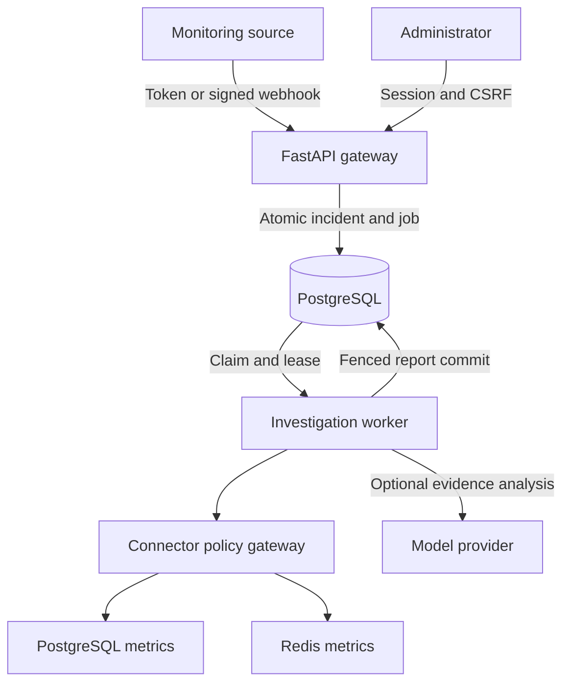
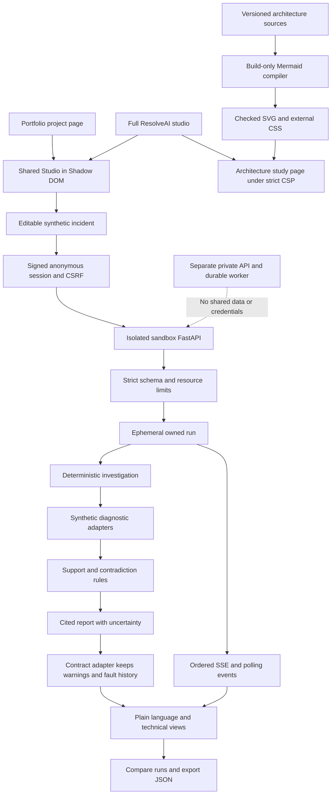
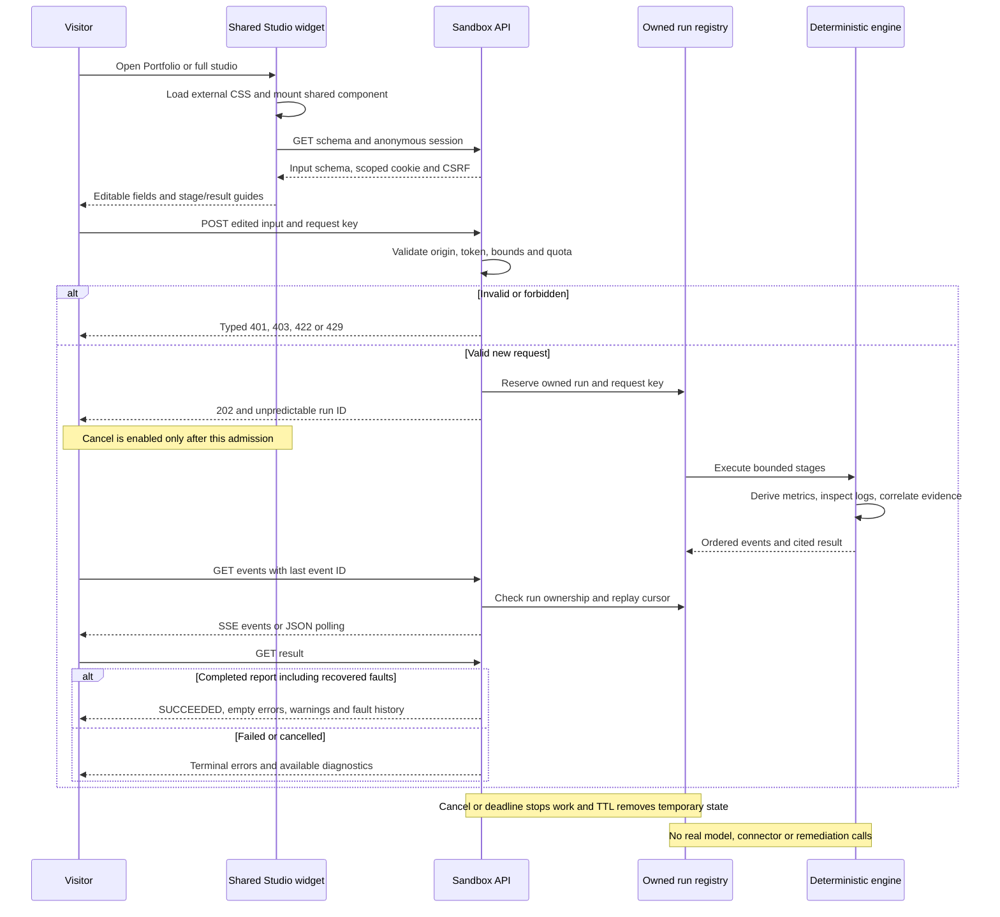
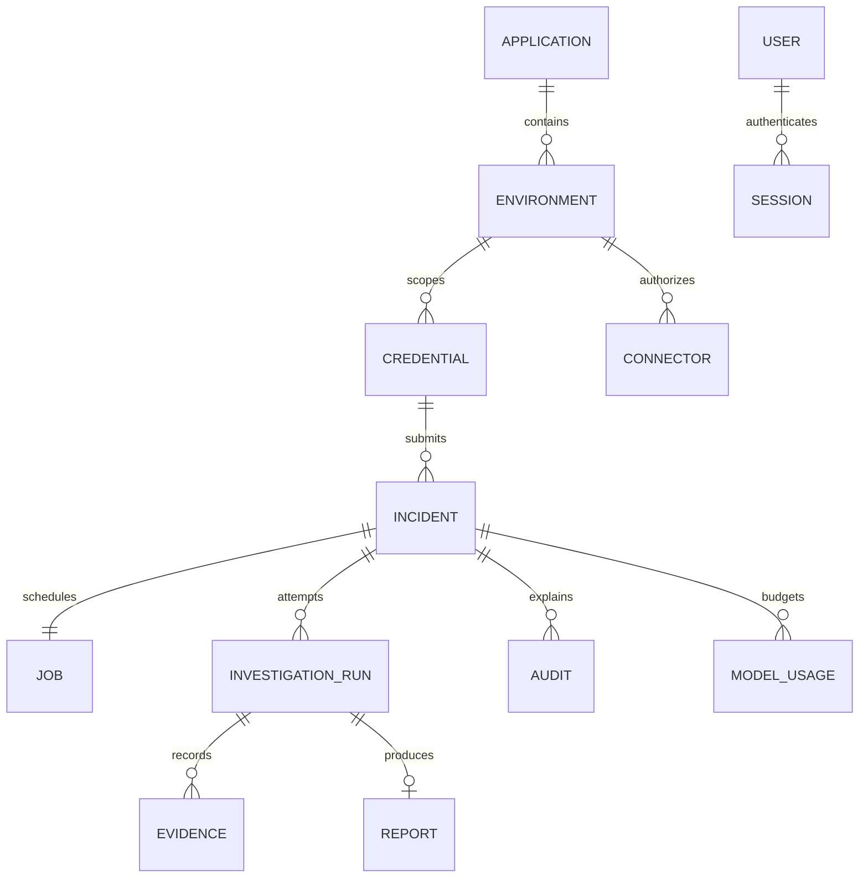

# ResolveAI architecture v2.0.10

Application v0.3.7 · 2026-10-13 · Source commit `e2f75c967712f38d5eae9719a4b1c4dae56307e3`

Verified standalone studio release with bounded private workers and portable project navigation.

## High-level architecture

### Two execution boundaries

Synthetic public computation and private durable work have different trust and recovery requirements.

The public entry point is app.sandbox.main. It accepts closed synthetic input and never imports the private API or opens a database connection. It exposes no credentials, connector configuration, arbitrary URL/SQL tools or paid inference routes. The deployment uses a dedicated internal network and no private data volume.

Public runs live in one bounded process: eight active runs globally, two per signed session, at most 256 retained runs, a four-second execution deadline and a ten-minute TTL. A restart invalidates sessions and runs. A 202 means ephemeral admission, not durable acceptance.

The separate app.main entry point retains authenticated administrator/integration identities, encrypted connector credentials, atomic PostgreSQL incident/job commits and fenced durable worker completion. Its 202 means work was committed durably. These guarantees must not be confused with the public sandbox.

Portfolio owns /projects/resolveai and mounts the ResolveAI-owned widget from /projects/resolveai/app/widget/resolveai-studio.js. The full studio at /projects/resolveai/app/studio imports the same component. Both call the existing /api/projects/resolveai sandbox; no extra backend or iframe is introduced. The legacy root app remains a separate preserved release.

- `app/sandbox/main.py` → `create_app`: Isolated public ASGI surface.

- `app/sandbox/runtime.py` → `RunStore`: Bounded ephemeral ownership and lifecycle.

- `app/main.py` → `API_BASE`: Configurable private API prefix.

### Editable signals produce new evidence

The server executes the submitted scenario rather than displaying an unchanged preset report.

Visitors can change error rate, latency, connection limits, database CPU/locks/slow-query counts, Redis memory/evictions, upstream 429 counts and deployment context. Logs are selected by allowlisted fixture ID. A malicious-instruction fixture is quarantined, never interpreted as authority.

Every editable signal has a plain-language definition, a concrete example, its permitted range and its effect on the deterministic rules. Valid ranges come from the discovered input schema; diagnostic thresholds are explained separately. Service name, incident text and seed are explicitly distinguished from diagnostic signals.

Severity reuses the same pure policy as the private investigator. Synthetic adapters derive evidence from the validated metrics. Correlation checks support, competing signals and an unrelated decoy. Weak evidence yields abstention rather than an invented cause.

All nine stages can be studied before execution. Plain-language and technical guides each explain what a stage receives, does, outputs and how errors are handled. A separate observed area shows only actual server events and completed checkpoint receipts. The result guide explains severity, evidence, hypotheses, uncertainty, human actions, timing, cost, provenance and export.

Plain-language results explain impact, uncertainty and human next steps. Technical results expose sanitized inputs, rule decisions, citations, observed stages, versions and actual elapsed durations. No chain-of-thought is collected.

Historical private backend recordings remain available as explicitly recorded artifacts. SANDBOX_DETERMINISTIC means new rule execution; REPLAY_RECORDED means an existing capture; authenticated live inference is unavailable to public visitors.

Explanations have one source in the ResolveAI application. A release builds both the full app and embedded widget, so the Portfolio picks up new guidance through the same current app release. The strict Portfolio security policy is retained; scripts, styles and API calls remain same-origin.

Cancellation targets admitted work. During session refresh and request admission the browser has no run identifier, so Cancel remains disabled until the server acknowledges the current run.

An investigation can finish with incomplete evidence. Its successful result carries warnings and the retained fault history, while the shared errors array stays empty. A stopped or cancelled investigation retains errors and available diagnostics without claiming a completed report. The warning display stays visible in the Portfolio widget and full studio.

- `app/policies.py` → `severity`: Shared deterministic severity policy.

- `app/sandbox/engine.py` → `report_for`: Evidence-derived hypotheses and provenance.

- `web/src/Studio.tsx` → `Studio`: Input editor, ordered events and both result views.

- `web/src/studioInputHelp.ts` → `inputHelp`: Field definitions, examples, rule explanations and safe option meanings.

- `web/src/StudioGuide.tsx` → `ProcessingGuide`: Separate study explanations from observed run evidence in both audience views.

### The gateway accepts work durably

An HTTP success means the alert and the obligation to process it have been committed.

FastAPI validates a strict Pydantic contract and derives the environment from the authenticated integration credential. A submitted payload cannot choose another application or environment.

The ingestion service inserts the incident and its job in one transaction. If the process fails after commit, the durable job remains. If the transaction fails, no new 202 response is returned.

An event ID is unique within its integration source. Sending the same body again returns the existing incident. Reusing an event ID for changed data returns a conflict. Different integrations can use the same external event ID.

- `app/schemas/contracts.py` → `IncidentCreate`: Defines bounded event fields and rejects unknown fields.

- `app/services/incidents.py` → `ingest`: Owns deduplication and the incident/job transaction.

### The worker owns execution, temporarily

A lease allows another worker to recover abandoned work without accepting a stale result.

The worker selects eligible jobs using a row lock with SKIP LOCKED, increments the claim version, and commits ownership before contacting any external service. It does not hold that transaction while waiting for a connector or model.

A heartbeat extends ownership during bounded execution. Every final write requires the same job ID, worker owner, claim version, active state, and unexpired lease. A crashed worker cannot later overwrite the replacement worker’s result.

Retry timing and attempts live in PostgreSQL. After three failed attempts, the job remains visible as DEAD_LETTER and the incident requires review. An operator can request a bounded retry. A report being ready never means the production incident is resolved.

- `app/jobs/worker.py` → `claim`: Atomically establishes job ownership.

- `app/jobs/worker.py` → `fence`: Defines conditions for valid completion and heartbeat writes.

### Diagnostics are capabilities, not arbitrary execution

A connector can perform only named operations on an explicitly permitted destination.

PostgreSQL operations are fixed aggregate queries. Redis operations are selected INFO sections and a health check. No raw SQL, shell, arbitrary URL, Redis value access, or remediation tool is offered.

The connector gateway checks the environment, enabled state, operation allowlist, exact destination IP, network allowlist, timeout, and result size. DNS destinations are disabled in v0.1 to avoid rebinding ambiguity. Link-local and metadata destinations are rejected.

Connector secrets are encrypted with a key stored outside PostgreSQL. The model receives sanitized evidence only. Redaction is a practical safeguard with limitations, not proof that every possible secret format is detected.

- `app/connectors/gateway.py` → `execute`: Authorizes and bounds every diagnostic operation.

- `app/core/security.py` → `encrypt`: Protects stored connector and webhook secrets.

### A model is optional and constrained

The public investigation requires no model key; private model failures retain useful evidence.

Private local inference uses an explicitly configured OpenAI-compatible endpoint, existing database request reservations, bounded timeout/output and citation validation. The adapter cannot invoke tools or remediation.

AgentOpsBridge checks an authenticated control-plane policy. The observed AgentOps gateway currently exposes synthetic routing only, so ResolveAI returns AI_UNAVAILABLE for live diagnosis. An unapproved live payload contract returns POLICY_BLOCKED. No successful live connection is claimed.

Model fallback means trying another eligible model within one request. Workflow fallback means retaining deterministic diagnostic analysis and human review. The public provider-error examples demonstrate the latter using mock faults; they do not contact real providers.

An expired or mismatched cached policy cannot authorize inference. Even an unexpired policy cannot permit local billable fallback when central quota reservation is unavailable. The private worker stores this outcome and preserves its incident/report state.

- `app/agents/routing.py` → `AgentOpsBridge`: Authenticated policy boundary and typed refusal.

- `app/agents/routing.py` → `safe_fallback`: Scope, expiry and central-quota constraints.

- `app/jobs/worker.py` → `gather`: Retains evidence when AI is unavailable.

### Architecture visuals obey the host security policy

The browser displays prepared diagrams without running the diagram compiler.

The release contains scalable SVG markup and a same-origin stylesheet generated from each versioned Mermaid definition. Labels and arrows keep their colors when the Portfolio enforces style-src self; no unsafe-inline, nonce exception or host-policy change is introduced.

A normal application build verifies every source and asset checksum. Diagram authors explicitly regenerate assets using the pinned build-only Mermaid CLI and an installed Chromium executable. The generator does not download a browser. Mermaid is not part of the runtime application bundle.

The study page accepts only an exact match between the API diagram source and the compiled manifest. An unknown source produces an accessible explanation and escaped source text instead of dynamically interpreting or inserting it.

- `web/src/ArchitectureDiagram.tsx` → `ArchitectureDiagram`: Displays only compiled diagram assets and preserves the source fallback.

- `web/scripts/generate-diagram-assets.mjs` → `externalizeStyles`: Renders immutable sources offline and extracts their styles.

- `web/scripts/check-diagram-assets.mjs` → `stylesheet_sha256`: Fails the build on source drift, asset tampering or inline styling.

## Low-level architecture

### Anonymous execution, ownership and replay

A run ID is a locator, not an authorization credential.

The schema endpoint creates or reuses a thirty-minute HttpOnly SameSite=Strict session scoped to /api/projects/resolveai and returns an independent CSRF token. HTTPS enables Secure cookies. POST requires both the signed session and the exact configured origin/token.

RunStore.start performs idempotency comparison and capacity reservation without yielding. Because the configured sandbox has one event loop and one worker, competing admissions cannot bypass its global limit. Multiple process replicas would need shared admission/state and are explicitly unsupported.

A repeated client_correlation_id with identical normalized input returns the existing owned run; changed input returns 409. A different session receives 404 for the same run ID. Expired session identities require a fresh session, and expired results return 410.

Each observed action has a monotonically increasing per-run sequence, event ID, mode, overview and sanitized technical metadata. SSE supports Last-Event-ID and terminal completion; JSON polling returns a bounded history. The client deduplicates and orders events, rejects conflicts and confirms a contiguous sequence before accepting a final result.

Cancellation, controlled connector timeouts, mock provider 429/invalid output and the four-second deadline have explicit outcomes. Missing database evidence is not treated as healthy evidence. A fake-ticket adapter demonstrates two retries producing one synthetic record and no real ticket.

Completed runs retain a semantic hash of deterministic output separately from variable run IDs and measured timing. Same input and versions produce the same semantic result. The sixty-millisecond cooperative checkpoint pacing is disclosed and included in durations.

Cancellation appends one fault object with code, message and retryable state, then references it from the active BLOCKED event before finishing CANCELLED. Polling and SSE use the same wire serializer; both require the message. The cancellation regression covers both transports and the final typed result.

- `app/sandbox/main.py` → `identity`: Signed ownership and mutation controls.

- `app/sandbox/runtime.py` → `start`: Atomic admission and idempotency.

- `app/sandbox/runtime.py` → `execute`: Observed workflow and failure paths.

- `web/src/studioClient.ts` → `mergeSteps`: Ordered event reconciliation.

- `app/sandbox/effects.py` → `SyntheticTickets`: Scoped fake-ticket idempotency.

- `tests/sandbox/test_studio.py` → `test_cancellation_events_remain_readable_through_polling_and_sse`: Verify cancellation history can still be streamed, polled and resolved to a final record.

### Request contracts and identity separation

Browser sessions and integration credentials are different capabilities.

An administrator password is stored as an Argon2 hash. The session cookie is HttpOnly, SameSite=Strict, and secure in HTTPS deployments. The server stores only the hash of the session token, with expiration. State changes also require an origin match and a CSRF token.

Integration tokens are high-entropy opaque strings, revealed once and hashed at rest. Their environment binding is looked up on the server. They can ingest and read incidents from their own source, but cannot configure the product or log in as administrator.

Webhook signatures cover the timestamp, a dot separator, and the exact raw request body. A five-minute timestamp tolerance and persisted replay key reject stale or repeated signed requests. Both the replay reservation and new incident are committed together.

- `app/core/security.py` → `owner`: Validates administrator session and mutation protection.

- `app/core/security.py` → `integration`: Authenticates and rate-limits source credentials.

- `app/main.py` → `webhook`: Checks HMAC and reserves replay identity.

### Pydantic schema versus SQLAlchemy model

The request schema describes acceptable input; the persisted model describes durable state.

IncidentCreate validates percentages, nonblank identifiers, bounded message lengths, timezone-aware dates, and declared investigation modes. It rejects arbitrary destination fields and unknown properties.

The Incident model includes internal identity, source binding, payload hash, normalized severity, processing status, and timestamps. Those values are not all supplied by the sender.

Alembic creates the schema. Foreign keys connect incidents to credentials and environments. A unique source/event constraint makes deduplication survive concurrent requests. Indexes support filtered incident lists and eligible-job selection.

- `app/schemas/contracts.py` → `IncidentCreate`: Input validation contract.

- `app/models/incident.py` → `class Incident`: Persisted incident state and database constraints.

- `app/models/incident.py` → `class Job`: Durable queue state and claim ownership.

### Transaction and recovery boundaries

Small database transactions protect invariants while external work happens outside them.

Ingest first checks for a prior event, then relies on the unique database constraint for races. The incident, processing marker, and acceptance audit event share one commit. A competing duplicate maps back to the stored incident.

The claim transaction locks one eligible job, marks abandoned attempts, creates an investigation run, advances the claim version, and records INVESTIGATING. The actual connector calls run after this transaction closes.

Completion first updates the job with fencing conditions. Only if that conditional write succeeds are evidence, the current report, run completion, incident status, and audit saved in the same transaction. A stale worker returns without saving a report.

- `app/services/incidents.py` → `ingest`: Commit-before-202 and race-safe deduplication.

- `app/jobs/worker.py` → `complete`: Fenced atomic finalization.

- `app/jobs/worker.py` → `fail`: Persisted retry/backoff and visible terminal failure.

### Connector execution and evidence transformation

The adapter owns credentials; the investigator owns only sanitized diagnostic facts.

Connector registration requires an existing environment, an allowed IP destination, and the external encryption key. Up to four connectors can be registered per environment. The API never returns their encrypted or plaintext secrets.

The PostgreSQL adapter enables a read-only session and short statement timeout, then executes fixed catalog queries. Monitoring-role visibility can limit wait metrics; database counters do not independently prove application connection-pool exhaustion.

The Redis adapter requests only selected memory and statistics fields, then keeps numeric allowlisted values. A restricted Redis ACL is independently required; gateway checks and server permissions provide separate protections.

Unavailable connectors produce recorded partial collection outcomes. A missing provider or failed analysis must not be mislabeled as successful live AI.

- `app/connectors/gateway.py` → `destination`: Validates IP-only destination policy.

- `app/connectors/gateway.py` → `OPERATIONS`: Lists the exact diagnostic capabilities.

- `app/jobs/worker.py` → `gather`: Collects evidence outside long-running database transactions.

### Presentation and integration paths

One React Studio serves the canonical Portfolio page and full app, with CSS and lifecycle boundaries.

Portfolio renders the resolveai-studio custom element and a same-origin ES module. The ResolveAI widget build bundles React and emits resolveai-studio.css beside it. Module registration creates an open shadow root; external CSS loads before React mounts. No styles or script code are injected inline.

The shared Studio discovers schema and canonical preset_id/title presets, validates run identity and ordered event history, then renders the same input help, nine stage guides, observations and final result for both entry points. The old generic Portfolio adapter is not used for ResolveAI.

Shadow DOM prevents the Portfolio generic studio selectors from changing the application controls. Accessible labels and live regions remain inside the shadow tree. Returning to the stage list uses a component ref rather than document-wide fragment resolution.

A stylesheet failure produces an accessible error and a full-studio link. A React render failure is caught by WidgetBoundary. A module failure leaves the static Portfolio fallback. Removing the element unmounts Studio, which aborts discovery/requests, closes SSE and clears polling. A stale load callback cannot mount after disconnect.

The existing app static route serves the widget with no-cache and same-origin CSP. Publish the ResolveAI release before the Portfolio loader; rollback the Portfolio pointer before reverting to an app release that lacks the widget. Other project pages, shared edge configuration and legacy root pages are preserved.

Studio disables Cancel when run is null or terminal. start clears any prior run before session refresh and request creation, so the control can only target the new admitted run. Terminal status disables cancellation while the final result is being loaded.

- `web/src/widget.tsx` → `ResolveAIStudio`: Custom element, isolated styles, fallback and unmount lifecycle.

- `web/vite.widget.config.ts` → `defineConfig`: Production bundled widget and external CSS emitted in the app release.

- `web/src/StudioGuide.tsx` → `stageList`: Keyboard return navigation works in full app and shadow tree.

- `web/src/Studio.tsx` → `Studio`: Single implementation for editing, observations and learning guides.

### Architecture records and release linkage

Documentation changes are part of the implementation, not a later handover task.

architecture/index.json identifies the current version and retained historical snapshots. Each snapshot includes its architecture version, application version, date, source commit, diagrams, explanations, code references, and change notes.

The architecture checker hashes the source paths that define behavior and deployment. If code changes without a reviewed snapshot update, the consistency check fails. A separate history check prevents editing a snapshot already committed in the comparison branch.

The Markdown architecture document is rendered from the same record used by the API and browser. The fingerprint detects changes; a maintainer must still review whether the explanation accurately captures their meaning.

- `scripts/architecture.py` → `fingerprint`: Detects architecture-affecting source changes.

- `scripts/architecture.py` → `render`: Generates repository documentation from the canonical record.

- `app/main.py` → `architecture_version`: Serves only versions explicitly listed in the index.

### Pinned public contract adapter

Internal domain details and the shared wire envelope evolve independently.

Contracts 1.0.0 is a verified local release. ResolveAI pins its schema checksums and tests real endpoint responses. It preserves the starter schemas only for historical study; they are not the current wire contract.

The shared schema and presets describe permitted input and its canonical SHA-256. The start envelope carries seed and client correlation ID. Run state carries ownership-scoped lifecycle data, expiry and provenance. Domain validation is narrower than the generic envelope.

SSE emits step events with numeric IDs and a final end event. Reconnection cursors must agree, foreign runs return 404, expired logs return 410, and malformed or impossible cursors return 409. Polling uses the same ordered events. Both edge-stripped and full-prefix HTTP paths are supported.

Canonical technical events carry action, schema versions, input/output references, decisions and evidence hashes. The completed output preserves full synthetic evidence_ledger and step_details, so the UI can inspect each referenced action. Generic protocol errors remain typed; detailed controlled-fault labels remain in output.faults.

Public simulation contract adoption does not prove cross-project event ingestion, knowledge lookup, or live model integration. Those capabilities remain separately gated and are reported explicitly in the release handoff.

wire.result maps domain errors by terminal state: SUCCEEDED maps to an empty canonical errors array, but every domain fault remains in output.faults, its message in warnings, and its original failed or blocked checkpoint in output.step_details. FAILED and CANCELLED retain typed canonical errors. No engine evidence or domain state is erased.

The UI resultOutcome reads warnings and output.faults; the diagnostic panel reads output.faults independently of canonical errors. A recovered connector timeout therefore still says Completed with warnings and exposes CONNECTOR_TIMEOUT even though portable clients accept the result.

The test-only upstream SchemaRegistry is vendored without changes and hash checked against Contracts 1.0.0. Unlike shape-only JSON Schema checks, its semantic checks reject success with errors, inconsistent versions/cost markers and sandbox provider execution. The local HTTP probe tests real cookie/CSRF admission, all controlled faults, cancellation, replay and repeatable seed output.

Historical recordings are immutable examples rather than current-release execution evidence. tests/recorded-simulations.json binds their bytes, original application version and code fingerprint to their historical source tree. The complete backend test suite separately executes the current private pipeline and public sandbox.

Date-time format validation is optional in jsonschema unless its checker dependency is installed. ResolveAI pins the upstream SDK jsonschema and rfc3339-validator versions in the test dependency lock and tests an impossible calendar timestamp, preventing a fresh environment from silently skipping that format gate. The test-only validator remains outside the runtime image.

- `app/sandbox/wire.py` → `install_openapi`: Maps domain results to pinned shared schema resources.

- `contracts/ADOPTION.md` → ``: Exact local contract release and adoption scope.

- `tests/sandbox/test_studio.py` → `test_pinned_metadata_errors_and_stripped_paths`: Tests actual metadata, run, event and error envelopes.

- `scripts/check_contract_adoption.py` → `semantic_output`: Real HTTP verification with explicit repeatability exclusions for duration and generated identifiers.

- `web/src/studioProcessHelp.ts` → `resultOutcome`: Keep successful partial-evidence warnings visible without relying on terminal errors.

- `tests/test_simulations.py` → `HISTORICAL`: Verify original recorded bytes and provenance independently from current application version.

### Diagram compilation, matching and zoom

The build owns layout; the browser owns only bounded viewing state.

The compiler deduplicates exact sources with SHA-256 and uses that digest as the SVG ID. It parses SVG as XML, rejects active/external content, removes style elements, and moves valid former-inline declarations to ID-scoped external CSS with preserved cascade priority. Invalid ER-style fragments are discarded by CSSOM just as a browser discards them.

The generated manifest records exact source text and hashes of each SVG and the shared stylesheet. Vite bundles only these checked assets into the lazy architecture view. Runtime Mermaid rendering and API-supplied HTML insertion are removed.

Zoom changes a data-zoom attribute through bounded 25-percent increments from 100 to 500 percent. External stylesheet selectors set the width; no inline style is required. The diagram viewport is keyboard-focusable and scrollable. Fit resets width and both scroll positions. A changed source remounts at Fit.

Verification uses the same strict policy as the frozen Portfolio, checks computed shape/text/edge styles and fresh-reload violation events, and exercises both HLD/LLD, zoom/Fit and an unavailable-source response. Browser-tool CSP events are measured on a no-application control page and recorded separately.

- `web/scripts/diagram-assets.mjs` → `externalizeStyles`: Separates SVG markup from CSS without retaining active content.

- `web/src/ArchitectureDiagram.tsx` → `DiagramCanvas`: Exact source matching, visible fallback and bounded viewing controls.

- `web/src/styles.css` → `.diagram-canvas[data-zoom="500"]`: External CSS controls magnification under style-src self.

## Change input, inspect evidence and recover from a failure

1. **Start a real sandbox run** — Select payment outage and submit the preset. The server validates it and assigns a session-owned run ID. (`app/sandbox/main.py:start`)

2. **Inspect the stages** — Select each stage before running to study its inputs, work, outputs and errors in both views. Then run the preset and compare those guides with the separately labelled observed events and recorded outputs. (`web/src/Studio.tsx:Studio`)

3. **Change one signal** — Lower DB connections from 96 to 20 and run again. Connection pressure loses support while severity remains driven by error rate. Compare the two reports. (`app/sandbox/engine.py:correlate`)

4. **Try invalid input** — Enter error_rate 120 or add an unknown JSON field. The server rejects the request with field errors before creating a run; your editor content remains available to correct. (`app/sandbox/contracts.py:SimulationInput`)

5. **Simulate a missing diagnostic** — Choose connector_timeout. The report retains other evidence, removes unavailable database evidence and states uncertainty. No real connector was contacted. (`app/sandbox/runtime.py:execute`)

6. **Study cancellation and expiry** — Choose workflow_timeout and cancel during execution. The active stage shows cancellation, later stages remain unobserved and the final record explains that no report completed. Without cancellation the deadline fails the run. Compare this with a completed investigation that has no supported cause. (`app/sandbox/runtime.py:RunStore`)

## Follow one alert from HTTP to a report

1. **Start at the boundary** — Read the events route. Identify where the integration token becomes a trusted source identity. Send a synthetic event and record the returned UUID. (`app/main.py · events`)

2. **Find the moment of acceptance** — Read ingest. Identify the single commit that makes both the incident and its job durable. Explain why returning before this point could lose accepted work. (`app/services/incidents.py · ingest`)

3. **Observe the worker** — Run the worker once in an isolated environment. Follow claim, gather, and complete. Inspect the three corresponding audit entries. (`app/jobs/worker.py · run_once`)

4. **Check the evidence** — Open the report and click an evidence reference. Compare the report citation with the stored evidence ID and source. Distinguish a plausible hypothesis from an independently verified root cause. (`web/src/main.tsx · ReportView`)

## Understand a worker crash and stale completion

1. **Create unfinished work** — In the disposable test environment, accept an incident and claim it without completing it. Inspect owner, version, lease_until, and attempts. (`tests/test_pipeline.py · test_claim_exclusion_expiry_and_stale_fence`)

2. **Expire the lease** — The recovery test advances the lease into the past. A second worker claims the same logical job and receives a larger claim version. (`app/jobs/worker.py · claim`)

3. **Try the old result** — Call complete with the old claim. It must return false and leave no stale report. The new claim can complete exactly one current report. (`app/jobs/worker.py · fence`)

4. **Exhaust recovery** — Read the bounded retry test. Explain the difference between a dead-letter job, an investigation needing review, and an operational incident being resolved. (`tests/test_pipeline.py · test_retries_exhaust_and_safe_replay`)

## Trace a denied connector operation

1. **Separate permission layers** — Identify the environment binding, network policy, operation allowlist, and database/Redis server permissions. Each answers a different authorization question. (`app/connectors/gateway.py · execute`)

2. **Try a forbidden operation safely** — Run the isolated negative tests. Arbitrary SQL, Redis value access, other-environment requests, and metadata destinations must be rejected before a useful external operation occurs. (`tests/test_pipeline.py · test_connector_permission_and_injection`)

3. **Read an incomplete report** — Disable live provider configuration and request a live investigation in the private test instance. It must show needs_configuration and NEEDS_REVIEW without claiming live analysis. (`tests/test_pipeline.py · test_live_without_key_does_not_claim_live_ai`)

## Make one change and update its explanation

1. **Choose a small behavior** — For example, change a severity threshold and its boundary tests. Write down the expected behavior before editing. (`app/agents/investigate.py · severity`)

2. **Observe documentation drift** — Run python scripts/architecture.py --check. A change in tracked implementation files should fail the fingerprint comparison. (`scripts/architecture.py · check`)

3. **Publish a new architecture snapshot** — Copy the current JSON to a new version, explain what changed and why, update the source commit and fingerprint, and prepend its metadata to the index. Retain the previous snapshot. (`architecture/versions/`)

4. **Verify and study** — Regenerate Markdown, run the suite and architecture checks, then compare the selectable browser versions. Deploy only after the release gates pass. (`docs/ARCHITECTURE_VERSIONING.md`)

## Version changes

- Pin the architecture source reference to the complete verified implementation commit, including private-worker heartbeat and standalone navigation.

- Preserve all prior snapshots and their recorded provenance; no runtime contract or schema change.
