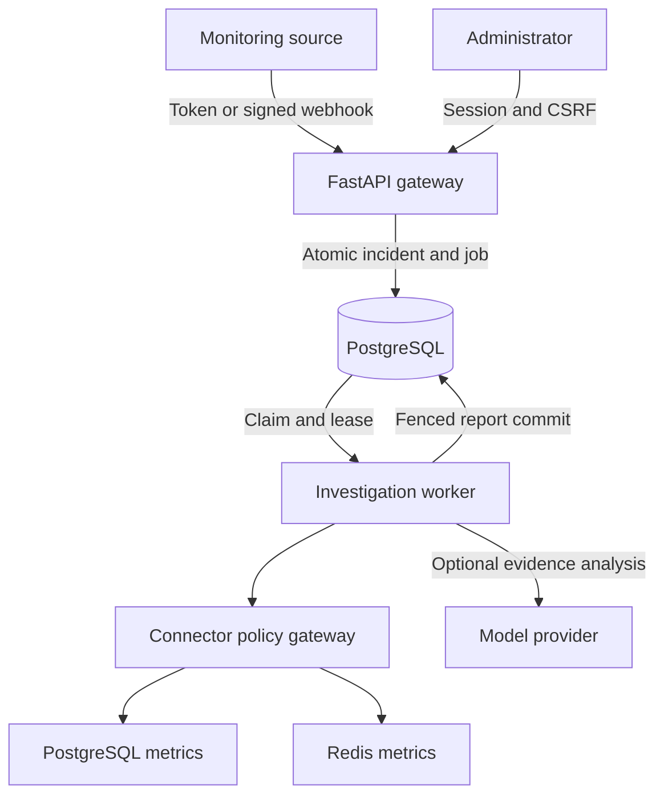
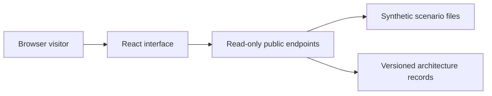
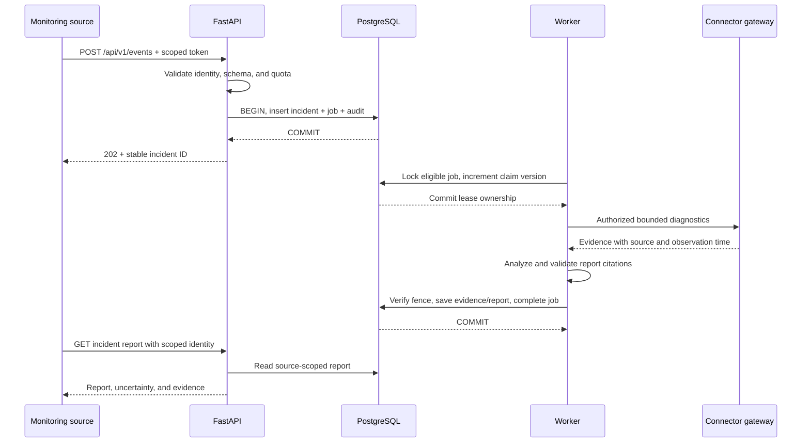
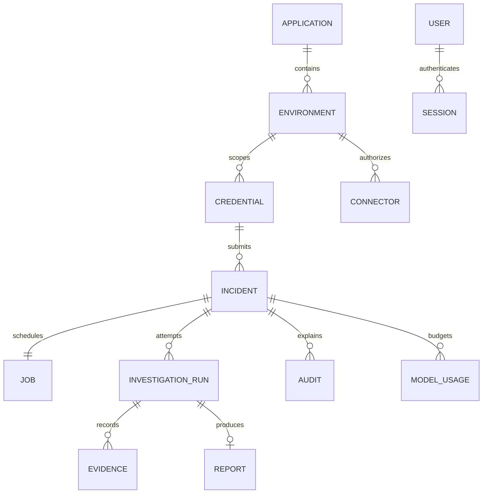

# ResolveAI architecture v1.0.1

Application v0.1.0 · 2026-10-13 · Source commit `330426a578102802716bffb317c8c65630c443c8`

ResolveAI is a single-tenant incident investigation application. The private workspace accepts scoped alerts and persists investigation work in PostgreSQL. A separate public demo reads synthetic scenarios only. Findings cite evidence; an operator decides whether to act.

## High-level architecture

### Two operating modes, one understandable codebase

The public experience is a controlled learning sandbox. The private experience performs authenticated investigations.

Public mode rejects state-changing requests before database dependencies run. Its scenario endpoints read bounded JSON fixtures and apply deterministic evidence rules. The browser animates the recorded steps; this animation is not a live investigation.

For the constrained public VPS, scripts/export_demo.py exports the exact public scenario and architecture responses as static JSON beside the React build. The existing HTTPS proxy serves these files; there is no public Python process, database, or credential store. The container demo remains available for self-hosting.

Private mode enables administrator sessions, application and environment setup, scoped credentials, diagnostic connectors, and durable worker processing. Public and private deployments must have separate configuration and credentials. The public Compose profile does not start a database or worker.

An application is a monitored product. An environment identifies its deployment context, such as staging or production. This v0.1 product has one administrator, not independent customer tenants.

- `app/main.py` → `guards`: Enforces public read-only mode before processing request bodies.

- `app/main.py` → `demo_scenario`: Builds a reproducible synthetic report from fixture evidence.

- `scripts/export_demo.py` → `export`: Builds a public-only static representation from the same canonical endpoints.

### The gateway accepts work durably

An HTTP success means the alert and the obligation to process it have been committed.

FastAPI validates a strict Pydantic contract and derives the environment from the authenticated integration credential. A submitted payload cannot choose another application or environment.

The ingestion service inserts the incident and its job in one transaction. If the process fails after commit, the durable job remains. If the transaction fails, no new 202 response is returned.

An event ID is unique within its integration source. Sending the same body again returns the existing incident. Reusing an event ID for changed data returns a conflict. Different integrations can use the same external event ID.

- `app/schemas/contracts.py` → `IncidentCreate`: Defines bounded event fields and rejects unknown fields.

- `app/services/incidents.py` → `ingest`: Owns deduplication and the incident/job transaction.

### The worker owns execution, temporarily

A lease allows another worker to recover abandoned work without accepting a stale result.

The worker selects eligible jobs using a row lock with SKIP LOCKED, increments the claim version, and commits ownership before contacting any external service. It does not hold that transaction while waiting for a connector or model.

A heartbeat extends ownership during bounded execution. Every final write requires the same job ID, worker owner, claim version, active state, and unexpired lease. A crashed worker cannot later overwrite the replacement worker’s result.

Retry timing and attempts live in PostgreSQL. After three failed attempts, the job remains visible as DEAD_LETTER and the incident requires review. An operator can request a bounded retry. A report being ready never means the production incident is resolved.

- `app/jobs/worker.py` → `claim`: Atomically establishes job ownership.

- `app/jobs/worker.py` → `fence`: Defines conditions for valid completion and heartbeat writes.

### Diagnostics are capabilities, not arbitrary execution

A connector can perform only named operations on an explicitly permitted destination.

PostgreSQL operations are fixed aggregate queries. Redis operations are selected INFO sections and a health check. No raw SQL, shell, arbitrary URL, Redis value access, or remediation tool is offered.

The connector gateway checks the environment, enabled state, operation allowlist, exact destination IP, network allowlist, timeout, and result size. DNS destinations are disabled in v0.1 to avoid rebinding ambiguity. Link-local and metadata destinations are rejected.

Connector secrets are encrypted with a key stored outside PostgreSQL. The model receives sanitized evidence only. Redaction is a practical safeguard with limitations, not proof that every possible secret format is detected.

- `app/connectors/gateway.py` → `execute`: Authorizes and bounds every diagnostic operation.

- `app/core/security.py` → `encrypt`: Protects stored connector and webhook secrets.

### The explanation is inspectable

Reports connect hypotheses to evidence instead of hiding the basis for a recommendation.

The baseline severity comes from deterministic error-rate rules. Fixture analysis evaluates diagnostic numbers. Its ground-truth evaluation file stays in tests and is not passed into the investigator.

Optional live analysis uses a fixed provider adapter with a daily request reservation, bounded timeout and output size. It can return structured findings but has no tool execution authority. Missing configuration produces NEEDS_REVIEW with an explicit needs_configuration report.

The report validator rejects invented evidence IDs and unknown fields. Stored trace events describe observable operations and outcomes. Private model chain-of-thought is not collected.

- `app/agents/investigate.py` → `validate_report`: Validates schema and evidence references.

- `app/jobs/worker.py` → `reserve_usage`: Reserves model-call budget before an external request.

## Low-level architecture

### Request contracts and identity separation

Browser sessions and integration credentials are different capabilities.

An administrator password is stored as an Argon2 hash. The session cookie is HttpOnly, SameSite=Strict, and secure in HTTPS deployments. The server stores only the hash of the session token, with expiration. State changes also require an origin match and a CSRF token.

Integration tokens are high-entropy opaque strings, revealed once and hashed at rest. Their environment binding is looked up on the server. They can ingest and read incidents from their own source, but cannot configure the product or log in as administrator.

Webhook signatures cover the timestamp, a dot separator, and the exact raw request body. A five-minute timestamp tolerance and persisted replay key reject stale or repeated signed requests. Both the replay reservation and new incident are committed together.

- `app/core/security.py` → `owner`: Validates administrator session and mutation protection.

- `app/core/security.py` → `integration`: Authenticates and rate-limits source credentials.

- `app/main.py` → `webhook`: Checks HMAC and reserves replay identity.

### Pydantic schema versus SQLAlchemy model

The request schema describes acceptable input; the persisted model describes durable state.

IncidentCreate validates percentages, nonblank identifiers, bounded message lengths, timezone-aware dates, and declared investigation modes. It rejects arbitrary destination fields and unknown properties.

The Incident model includes internal identity, source binding, payload hash, normalized severity, processing status, and timestamps. Those values are not all supplied by the sender.

Alembic creates the schema. Foreign keys connect incidents to credentials and environments. A unique source/event constraint makes deduplication survive concurrent requests. Indexes support filtered incident lists and eligible-job selection.

- `app/schemas/contracts.py` → `IncidentCreate`: Input validation contract.

- `app/models/incident.py` → `class Incident`: Persisted incident state and database constraints.

- `app/models/incident.py` → `class Job`: Durable queue state and claim ownership.

### Transaction and recovery boundaries

Small database transactions protect invariants while external work happens outside them.

Ingest first checks for a prior event, then relies on the unique database constraint for races. The incident, processing marker, and acceptance audit event share one commit. A competing duplicate maps back to the stored incident.

The claim transaction locks one eligible job, marks abandoned attempts, creates an investigation run, advances the claim version, and records INVESTIGATING. The actual connector calls run after this transaction closes.

Completion first updates the job with fencing conditions. Only if that conditional write succeeds are evidence, the current report, run completion, incident status, and audit saved in the same transaction. A stale worker returns without saving a report.

- `app/services/incidents.py` → `ingest`: Commit-before-202 and race-safe deduplication.

- `app/jobs/worker.py` → `complete`: Fenced atomic finalization.

- `app/jobs/worker.py` → `fail`: Persisted retry/backoff and visible terminal failure.

### Connector execution and evidence transformation

The adapter owns credentials; the investigator owns only sanitized diagnostic facts.

Connector registration requires an existing environment, an allowed IP destination, and the external encryption key. Up to four connectors can be registered per environment. The API never returns their encrypted or plaintext secrets.

The PostgreSQL adapter enables a read-only session and short statement timeout, then executes fixed catalog queries. Monitoring-role visibility can limit wait metrics; database counters do not independently prove application connection-pool exhaustion.

The Redis adapter requests only selected memory and statistics fields, then keeps numeric allowlisted values. A restricted Redis ACL is independently required; gateway checks and server permissions provide separate protections.

Unavailable connectors produce recorded partial collection outcomes. A missing provider or failed analysis must not be mislabeled as successful live AI.

- `app/connectors/gateway.py` → `destination`: Validates IP-only destination policy.

- `app/connectors/gateway.py` → `OPERATIONS`: Lists the exact diagnostic capabilities.

- `app/jobs/worker.py` → `gather`: Collects evidence outside long-running database transactions.

### Frontend state and report presentation

The browser renders server state and keeps synthetic replay unmistakable.

The React shell separates overview, incident list, report detail, integrations, operations, and architecture. The public replay timer reveals pre-existing timeline entries; it creates no server job and calls no model.

The report view presents hypotheses, cited evidence, uncertainty, and human-reviewed recommendations. It labels synthetic analysis and avoids describing recommendations as executed operations.

The shared API client sends cookies and the CSRF header on same-origin requests. Integration credentials are held only in the one-time reveal component and are never saved in browser local storage.

The architecture module and Mermaid renderer are loaded only when needed. Diagrams have readable explanations and expandable source. Smaller screens retain navigation, readable report sections, and scrollable diagram canvases.

- `web/src/api.ts` → `api`: Shared JSON client and safe error propagation.

- `web/src/main.tsx` → `ReportView`: Evidence-linked findings and uncertainty.

- `web/src/Architecture.tsx` → `ArchitecturePage`: Version selection and study views.

### Architecture records and release linkage

Documentation changes are part of the implementation, not a later handover task.

architecture/index.json identifies the current version and retained historical snapshots. Each snapshot includes its architecture version, application version, date, source commit, diagrams, explanations, code references, and change notes.

The architecture checker hashes the source paths that define behavior and deployment. If code changes without a reviewed snapshot update, the consistency check fails. A separate history check prevents editing a snapshot already committed in the comparison branch.

The Markdown architecture document is rendered from the same record used by the API and browser. The fingerprint detects changes; a maintainer must still review whether the explanation accurately captures their meaning.

- `scripts/architecture.py` → `fingerprint`: Detects architecture-affecting source changes.

- `scripts/architecture.py` → `render`: Generates repository documentation from the canonical record.

- `app/main.py` → `architecture_version`: Serves only versions explicitly listed in the index.

## Follow one alert from HTTP to a report

1. **Start at the boundary** — Read the events route. Identify where the integration token becomes a trusted source identity. Send a synthetic event and record the returned UUID. (`app/main.py · events`)

2. **Find the moment of acceptance** — Read ingest. Identify the single commit that makes both the incident and its job durable. Explain why returning before this point could lose accepted work. (`app/services/incidents.py · ingest`)

3. **Observe the worker** — Run the worker once in an isolated environment. Follow claim, gather, and complete. Inspect the three corresponding audit entries. (`app/jobs/worker.py · run_once`)

4. **Check the evidence** — Open the report and click an evidence reference. Compare the report citation with the stored evidence ID and source. Distinguish a plausible hypothesis from an independently verified root cause. (`web/src/main.tsx · ReportView`)

## Understand a worker crash and stale completion

1. **Create unfinished work** — In the disposable test environment, accept an incident and claim it without completing it. Inspect owner, version, lease_until, and attempts. (`tests/test_pipeline.py · test_claim_exclusion_expiry_and_stale_fence`)

2. **Expire the lease** — The recovery test advances the lease into the past. A second worker claims the same logical job and receives a larger claim version. (`app/jobs/worker.py · claim`)

3. **Try the old result** — Call complete with the old claim. It must return false and leave no stale report. The new claim can complete exactly one current report. (`app/jobs/worker.py · fence`)

4. **Exhaust recovery** — Read the bounded retry test. Explain the difference between a dead-letter job, an investigation needing review, and an operational incident being resolved. (`tests/test_pipeline.py · test_retries_exhaust_and_safe_replay`)

## Trace a denied connector operation

1. **Separate permission layers** — Identify the environment binding, network policy, operation allowlist, and database/Redis server permissions. Each answers a different authorization question. (`app/connectors/gateway.py · execute`)

2. **Try a forbidden operation safely** — Run the isolated negative tests. Arbitrary SQL, Redis value access, other-environment requests, and metadata destinations must be rejected before a useful external operation occurs. (`tests/test_pipeline.py · test_connector_permission_and_injection`)

3. **Read an incomplete report** — Disable live provider configuration and request a live investigation in the private test instance. It must show needs_configuration and NEEDS_REVIEW without claiming live analysis. (`tests/test_pipeline.py · test_live_without_key_does_not_claim_live_ai`)

## Make one change and update its explanation

1. **Choose a small behavior** — For example, change a severity threshold and its boundary tests. Write down the expected behavior before editing. (`app/agents/investigate.py · severity`)

2. **Observe documentation drift** — Run python scripts/architecture.py --check. A change in tracked implementation files should fail the fingerprint comparison. (`scripts/architecture.py · check`)

3. **Publish a new architecture snapshot** — Copy the current JSON to a new version, explain what changed and why, update the source commit and fingerprint, and prepend its metadata to the index. Retain the previous snapshot. (`architecture/versions/`)

4. **Verify and study** — Regenerate Markdown, run the suite and architecture checks, then compare the selectable browser versions. Deploy only after the release gates pass. (`docs/ARCHITECTURE_VERSIONING.md`)

## Version changes

- Improve sequence-diagram arrow, actor-border, and message contrast on dark backgrounds.

- Retain the published 1.0.0 snapshot unchanged; component and trust boundaries are unchanged.
